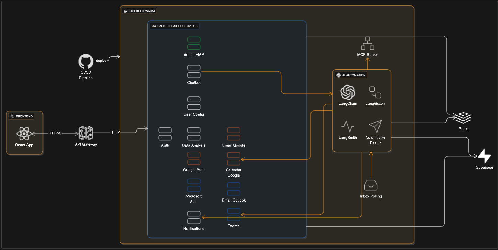
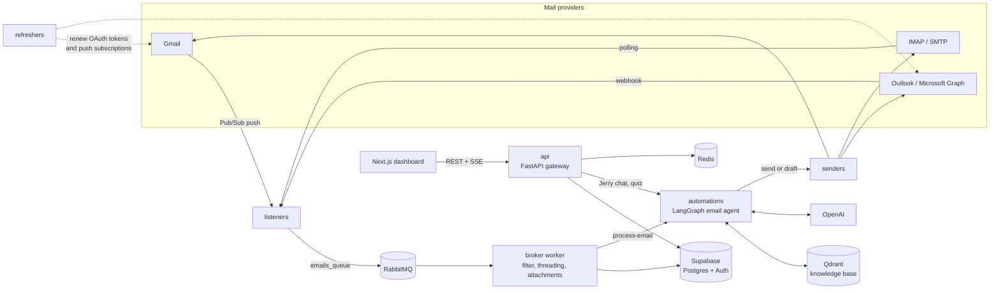
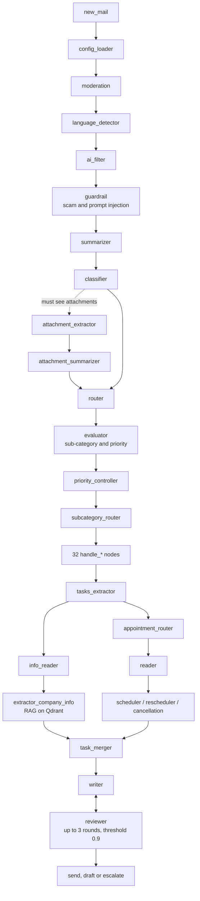

# InboxPilot

**AI agents that read, classify and answer customer-service email for small businesses.**

> [!WARNING]
> **This is an archived project. It is not maintained and it cannot be installed or run.**
> It was built between October 2025 and March 2026 by a small team for a startup that has since shut down.
> The code is published as-is, as a record of the work and as a source of ideas for anyone building something similar.
> See [Why you can't run it](#why-you-cant-run-it) and [About the 2025 tech stack](#about-the-2025-tech-stack) before reading the code.

The product was originally called *Corretto*, and that name (together with *Jerry*, the in-app assistant) still appears throughout the code.

---

## What it did

A business connected its mailbox (Gmail, Outlook or any IMAP/SMTP account), its calendar and its website. From then on, every incoming email went through a pipeline of LLM agents that:

- filtered spam, scams and prompt-injection attempts;
- summarised and classified the email (7 categories, 32 sub-categories, priority, confidence score);
- answered questions using a knowledge base built from the company's website and an onboarding questionnaire (RAG on Qdrant);
- booked, moved or cancelled appointments directly on Google Calendar or Outlook, respecting business hours and time zones;
- wrote a reply, had it checked by a second "reviewer" agent, and then either **sent it or left it as a draft** for a human to approve;
- escalated to a human (dashboard + email alert) when the email was dangerous, high priority or the model was not confident enough.

On top of that, the dashboard included **Jerry**, a chat assistant that could search, read, reply to, forward and draft emails, and schedule meetings on the user's behalf.

## Architecture



*The image above is the first design sketch (October 2025). The system that was actually built differs from it: it ran on k3s instead of Docker Swarm, and the MCP server and Teams integration never shipped. The diagram below reflects the final code.*



### Backend services (`backend/`)

| Service | What it does | Built with |
|---|---|---|
| `api` | Public gateway for the dashboard: auth (password, magic link, Google/Microsoft OAuth, custom IMAP), mailbox views, calendars, attachments, metrics, notifications, website scraper. Proxies the Jerry chat (SSE) and the onboarding quiz to `automations`. | FastAPI, Supabase, Redis |
| `automations` | The AI core: the LangGraph email agent (`ec_system`), the Jerry chatbot (`chatbot`) and the onboarding quiz (`quiz`). | FastAPI, LangChain, LangGraph, OpenAI, Qdrant |
| `listeners` | Three processes in one image: Gmail (Pub/Sub + History API), Microsoft Graph (webhook), IMAP poller. All of them normalise incoming mail and publish it to RabbitMQ. | asyncio, aio-pika, FastAPI |
| `broker/worker` | Consumes the queue, cleans and filters each email, rebuilds threads, downloads attachments, stores everything in Supabase and triggers the agent. | asyncio, aio-pika |
| `senders` | Sends replies or creates drafts through the Gmail API, Microsoft Graph, SMTP or IMAP APPEND, and emails alerts to the business owner. | FastAPI |
| `refreshers` | Background loops that refresh OAuth tokens, renew the Gmail `watch` and Microsoft Graph subscriptions, and clean up orphaned ones. | asyncio |
| `k8s` | Kustomize manifests for k3s: base workloads (plus Redis, RabbitMQ, Qdrant), production and staging overlays, HPAs, Traefik ingress, cert-manager. | Kubernetes |

### The email agent

The most interesting part of the project is the LangGraph graph in [`backend/automations/ec_system/graph`](backend/automations/ec_system/graph). It has 25 core nodes plus 32 sub-category handlers:



Every step uses structured outputs (Pydantic models in [`models/llm_responses.py`](backend/automations/ec_system/models/llm_responses.py)). The graph stops early when an email is dangerous, when classification confidence is low or when priority is high. Prompts are in Italian and English, the two languages the product supported.

### Jerry and onboarding

- **Jerry** ([`backend/automations/chatbot`](backend/automations/chatbot)) is a LangChain agent with ten email and calendar tools. Conversations are persisted with LangGraph's Postgres checkpointer.
- **Onboarding** builds the knowledge base the agent answers from. The API scrapes the company website (discover URLs → fetch → LLM clean-up → chunk → embed), then a conversational quiz fills the gaps. A save pipeline merges both into a single Qdrant collection per business.

### Frontend (`frontend/`)

A Next.js 15 (App Router) dashboard with a landing page, sign-up/login, a setup wizard (connect mailbox, calendar and business hours, scrape website, quiz), an inbox with human-review and failed-send views, a calendar, KPIs, settings and the floating Jerry chat. It has a custom Italian/English i18n context and is styled with Tailwind v4 and shadcn/ui. It talked to the backend through `NEXT_PUBLIC_API_URL`, authenticating with the Supabase access token, and was deployed on Vercel.

## Repository layout

```
.
├── backend/
│   ├── api/              FastAPI gateway (modules: auth, mailbox, calendars, metric, scraper, …)
│   ├── automations/      LangGraph email agent, Jerry chatbot, onboarding quiz
│   ├── broker/           RabbitMQ config and the queue worker
│   ├── listeners/        Gmail, Microsoft Graph and IMAP listeners
│   ├── senders/          Outbound email (Gmail, Graph, SMTP/IMAP)
│   ├── refreshers/       OAuth token and push-subscription renewal
│   ├── k8s/              Kustomize manifests (base + production/staging overlays)
│   ├── .github/          Original CI/CD workflow, kept for reference (inactive in this repo)
│   ├── docker-compose.yml
│   └── .env.example      Every environment variable the services expected
├── frontend/             Next.js dashboard
└── docs/
    ├── architecture.png  First architecture sketch
    └── openapi.json      OpenAPI spec of the api service
```

## Tech stack

Versions are the ones pinned in the code when development stopped.

| Area | Technologies |
|---|---|
| Language / runtime | Python 3.11 (`python:3.11-slim`), Node.js / TypeScript |
| AI | OpenAI `gpt-4o-mini`, `text-embedding-3-small`, `omni-moderation-latest`; LangChain 1.0, LangGraph 1.0, LangSmith tracing |
| Backend | FastAPI 0.10x–0.12x, aio-pika, httpx, BeautifulSoup, PyMuPDF / pdfminer, lingua |
| Data | Supabase (Postgres + Auth), Qdrant, Redis 7.4, RabbitMQ 3.13 |
| Integrations | Gmail API + Google Cloud Pub/Sub, Google Calendar, Microsoft Graph (mail, calendar, subscriptions), IMAP/SMTP |
| Frontend | Next.js 15.5, React 19.1, Tailwind CSS 4, shadcn/ui + Radix, react-hook-form + zod 4, Recharts, Framer Motion, GSAP |
| Infra | Docker, k3s, Kustomize, Traefik, cert-manager, GitHub Actions → GHCR, Vercel (frontend) |

## Why you can't run it

This repository is **not installable**, and there are no setup instructions on purpose:

- **The database schema is not here.** Tables, views and policies lived only in the Supabase project, and there are no migrations in the repo.
- **Every external account is gone or private**: Supabase, the Google Cloud project (OAuth app, Pub/Sub topic), the Microsoft Entra app registration, OpenAI, LangSmith, the k3s cluster and the container images on GHCR.
- **The original domains no longer serve the product**, and URLs that pointed to them are still hard-coded in places.
- **Configuration is secret by design.** `backend/.env.example` lists the variables, but only with placeholders.
- **The CI/CD workflow is inactive.** It is kept under `backend/.github/` for reference, and GitHub doesn't run workflows from that location.

Getting it to work again would mean recreating the schema from the DAO code, registering new OAuth apps and rebuilding the infrastructure. If you need a working product, start a new one. Use this as a reference, not a base.

## About the 2025 tech stack

The code reflects what was current in late 2025 and early 2026, and much of it has aged:

- **Models.** `gpt-4o-mini` was chosen for cost. Newer models are better and cheaper, and many of the workarounds in the prompts (strict JSON coaxing, a weekday-to-date table so the model doesn't miscount "next Monday", multiple review rounds) may no longer be needed.
- **Agent frameworks.** LangChain and LangGraph had just reached 1.0 when this was written. APIs, best practices and tooling (MCP, built-in tool calling, agent SDKs) have moved on since then.
- **Dependencies.** They are pinned to 2025 versions and have almost certainly collected security advisories since. **Don't deploy this code.**
- **Code quality.** It was written at startup speed by a student team. You will find leftover debug `print`s, some unused dependencies and modules, Italian and English mixed in prompts and comments, and a few half-finished features (for example, the human-feedback DAO and most of the metrics API are not wired into the UI).

## Ideas that may still be useful

- A **multi-stage email agent** with cheap guards first (moderation, language, scam and prompt-injection checks) and expensive generation last.
- **Writer/reviewer loop** with a numeric correctness threshold instead of a single generation pass.
- **Send vs. draft** as a per-business setting, plus automatic escalation on low confidence, giving a simple human-in-the-loop model.
- **One queue, many providers.** Gmail push, Graph webhooks and IMAP polling are all normalised into one message format before any AI runs.
- **Calendar booking from free text**: the prompt gets a weekday-to-date table and the business hours, and every booked event gets a short code that customers use to reschedule or cancel.
- A **knowledge base built from a website scrape plus a conversational quiz**, instead of asking the customer to upload documents.

## Team

Built by:

- **Emanuele Romano** ([@emanueleR3](https://github.com/emanueleR3))
- **Ferdinando Del Vecchio** ([@Ferd03dv](https://github.com/Ferd03dv))
- **Loris Catalano** ([@loris-catalano](https://github.com/loris-catalano))
- **Marco Donatucci** ([@marcodonatucci](https://github.com/marcodonatucci))

## About this repository

- The backend keeps its **full git history** (October 2025 to March 2026), moved under `backend/`. The two last active branches were merged into one final state.
- The frontend was developed in a separate repository and is imported here as a **single snapshot** of its last version (March 2026).
- Before publishing, personal email addresses, an expired access token and similar personal data were rewritten out of the entire history and replaced with `example.com` placeholders. Commit authors were mapped to their GitHub no-reply addresses.

No license is granted. The code is shared for reading and inspiration only.
